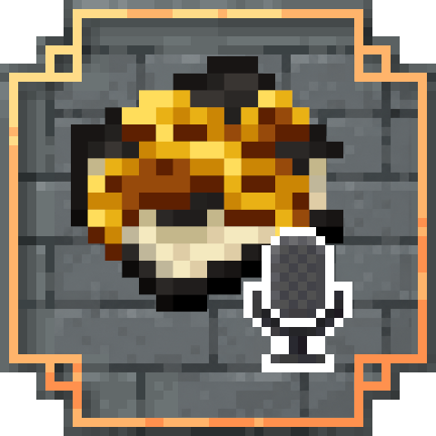
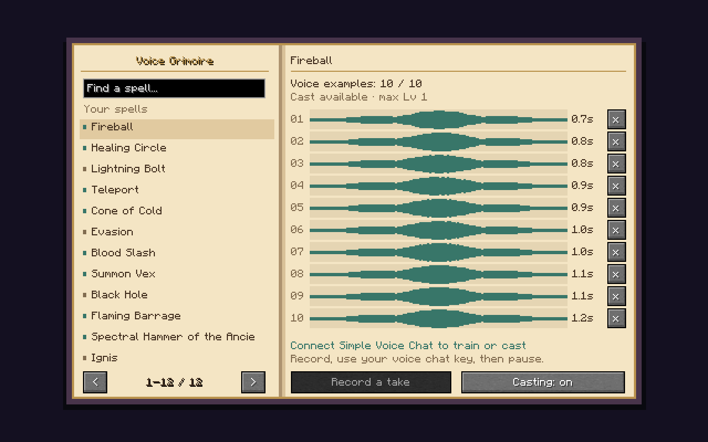
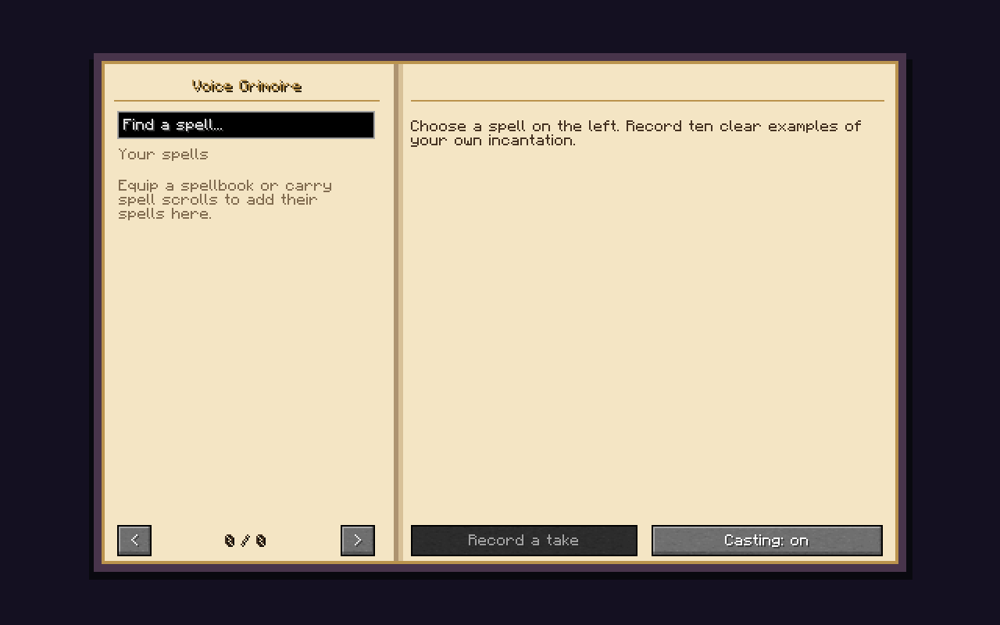

#  Iron's Spells STT — Speech to Spell

**Cast Iron's Spells 'n Spellbooks spells with your own voice.** Record an incantation, equip your spellbook and speak it during gameplay. Use spell names, invented words or another language: STS learns how **you** pronounce each phrase. The mod doesn't rely on external programs to convert your speech to text. It is fast, runs directly inside of Minecraft and highly customizable!

By **benterre** · [MIT license](LICENSE) · [Developed through AI](AI_PROMPTS.md)



*Actual in-game interface. The spell list and waveforms are synthetic demonstration data; no player recording is distributed.*

## Features

- Personal voice recognition running directly in Minecraft (no external STT required).
- Microphone capture through **Simple Voice Chat**.
- Automatic discovery of **Iron's Spells 'n Spellbooks** spells and compatible addon spells.
- A single **Voice Grimoire** to search spells, record up to ten takes per spell, inspect waveforms and delete individual takes.
- Remembers scrolls and their highest encountered level, with configurable casting of spells absent from the equipped book.
- Local recording files and lazy loading, so the full collection of raw audio does not remain in RAM during gameplay.

STS works best with incantations that are clearly isolated from your standard conversation; don't followup your sentence with the spell name without pauses (eg. "Oh hi Mark fireball").

I recommend saving ten recordings for each spell with different intonations, pitches and speeds for the best results. For example, you could record "Fireball" with a calm voice, a deep powerful-sounding voice, a fast panicking voice, etc.

Note that similar-sounding incantations can be confused.

## Install

1. Choose the STS JAR for your **loader and Minecraft version**. See the [compatibility guide](docs/compatibility.md).
2. Install [Iron's Spells 'n Spellbooks](https://www.curseforge.com/minecraft/mc-mods/irons-spells-n-spellbooks) and the dependencies required by that particular release.
3. Install [Simple Voice Chat](https://modrinth.com/plugin/simple-voice-chat). It is required for recording and voice casting. STS can load without it, but cannot listen for incantations.
4. Put one matching STS JAR in **both the client's and server's `mods` folders** for multiplayer. Singleplayer uses the integrated server in the same installation.
5. Configure your microphone and confirm that Simple Voice Chat connects. Dedicated servers need SVC's normal voice-network setup; STS does not replace it.

The current NeoForge 1.21.x build requires Java 21. Legacy targets and their Java requirements are listed in the compatibility guide. Check your dependencies' requirements too.

### Multiplayer installation

STS is required on **the server and every joining client**, including players who do not plan to use voice casting. Its required network channels reject connections when only one side has STS.

| Client has STS | Server has STS | Result |
|---|---|---|
| Yes | Yes | All STS features are available, subject to configuration and voice-chat setup. |
| No | Yes | Connection rejected: the client is missing STS. |
| Yes | No | Connection rejected: the server is missing STS. |
| No | No | Normal gameplay without STS, provided the rest of the modpack is compatible. |

The client handles microphone audio, training and recognition. The server tracks learnt spell levels, validates casts, applies mana costs and runs optional broadcasts. Simple Voice Chat is required for recording and voice casting; install and configure it on both sides for those features.

## Train your voice

1. Carry a spell scroll or equip a spellbook containing the spell. Encountered spells appear in the Grimoire and remain remembered after their items are removed.
2. Press **G**. Hover an inventory item and press G to open its spell page directly.
3. Select a spell from the left page. Use search and the page arrows as needed.
4. Click **Record a take**, then speak one incantation using your normal Simple Voice Chat activation method. With push-to-talk, hold its key while speaking.
5. Record **ten clear examples**, each under **three seconds**, using a consistent incantation. Use the `x` beside a waveform to delete a poor take and record a replacement.



*Carry scrolls or equip a spellbook to populate the list. Screenshot captured from the actual Minecraft screen.*

Training uses normal SVC traffic, so nearby or group players may hear your recordings as you make them. STS does not mute ordinary speech. Recognition runs locally while voice chat follows its usual network path.

## Cast spells

Equip the book in Iron's **spellbook Curios slot**, or hold a supported casting staff or wand. Older Iron releases cast from a book held in your hand; follow that release's native equipment rules. Close the Grimoire and say the incantation. Carrying a book in an ordinary inventory slot is insufficient.

- Prepared spells equipped in your spellbook are cast at their normal level and mana cost.
- By default, if you recorded a spell but removed it from your spellbook you can still use your voice to cast it but at **level 1 for 150% of its normal level-1 mana cost**.
- The optional maximum-level mode uses the highest encountered scroll level and costs **150% of the normal cost at that level**. Ink upgrades are observed when their scrolls enter your inventory; no new recording is needed.
- Optionally, you can also enable equipment-free casting to cast your recorded spells without a Grimoire or magic staff.

The **Casting: on/off** button toggles voice commands. Rebind G under **Options → Controls → Key Binds → STS**.

Compatible Iron's Spells 'n Spellbooks addons are automatically detected and their spells should appear in the voice Grimoire. Packs can identify other casting items with the `sts:casting_implements` item tag. Separate casting systems require their own integration.

## Configure

The mod creates **`config/sts/options.toml`** upon first launch. The server's settings control multiplayer casting.

| Option | Default | Effect |
|---|---|---|
| `grimoireless_cast_any_spell` | `true` | Cast remembered, unprepared spells at level 1 with the surcharge. |
| `grimoireless_cast_at_max_level` | `false` | Use the highest encountered level for unprepared spells; overrides level-1 mode. |
| `cast_without_wand` | `false` | Allow remembered casts without an equipped book or held casting implement. |

**WIP:** experimental voice effects are **off by default** (`broadcast_strong_spells=false`). They are optional and are described separately in the [effects guide](docs/phase5-voice-effects.md). Existing config values are preserved on upgrade; set this option to `false` in an older installation to disable it there.

## Storage and privacy

Personal recordings live in **`config/sts/voices/<player-uuid>/`** in your game directory. Back up that folder to preserve training. Players enroll positive incantations only; addon-specific negative examples are not required.

Ordinary STS cast requests send only a spell identifier, no voice data. Normal voice chat still follows SVC's usual audio pipeline. Experimental replay, if enabled, sends a short recording of the recognized incantation to the game server through Minecraft networking; the processed replay is then played through SVC. No external program or generative AI service is used at runtime. AI assisted coding, tests, research and documentation; see [AI_PROMPTS.md](AI_PROMPTS.md).

## Troubleshooting

| Problem | Check |
|---|---|
| No waveform | Connect and unmute SVC, select a spell, press Record and use the correct voice activation method. |
| Empty spell list | Carry a scroll or equip a spellbook in Curios; allow time for the server to synchronize unlocks. |
| A spell does not cast | Check equipment, mana, cooldowns, learning restrictions and the server's options. |
| Incantations are confused | Choose more distinct phrases and replace inconsistent takes. |
| G does not open an inventory page | Check for any input conflicts in the options. |
| A remembered spell casts at level 1 | This is the default policy. Maximum-level casting is a server option. |

Report versions, relevant options, reproduction steps and sanitized logs. Keep private conversations, voice recordings and credentials out of public issues.

## Project links

| Platform | Project |
|---|---|
| GitHub | [benterre/IronsSpellsSTT](https://github.com/benterre/IronsSpellsSTT) |
| CurseForge | [Iron's Spells Speech-to-spell](https://www.curseforge.com/minecraft/mc-mods/irons-spells-speech-to-spell/preview) |
| Modrinth | [Iron's Spells Speech-to-spell](https://modrinth.com/project/irons-spells-speech-to-spell) |

## Build and contribute

Use Java 21 and the checked-in Gradle wrapper. PowerShell 7.4+ fetches the checksum-pinned development dependencies:

```powershell
./tools/bootstrap.ps1 -IncludeAddons
./gradlew.bat build
./gradlew.bat -PgameTests -Paddons runGameTestServer
./gradlew.bat -PclientProbe runClientProbe
```

On other operating systems, use `./gradlew` (or `bash ./gradlew` if needed) and PowerShell 7.4+ for bootstrap scripts. The [compatibility guide](docs/compatibility.md) lists the six game/loader families and build commands. Real-speech evaluation requires private recordings deliberately excluded from Git.

Downloaded mods, game files, run directories and personal audio are not distributed with the source or STS JAR. Regression source is retained. [AI_PROMPTS.md](AI_PROMPTS.md) collects the project's Codex prompts.

## License

**MIT**, copyright **benterre**. Use STS in modpacks, modify it and redistribute it as you wish, including commercially, while preserving the copyright and license notice. Minecraft and dependencies retain their own licenses and are not bundled into STS.
